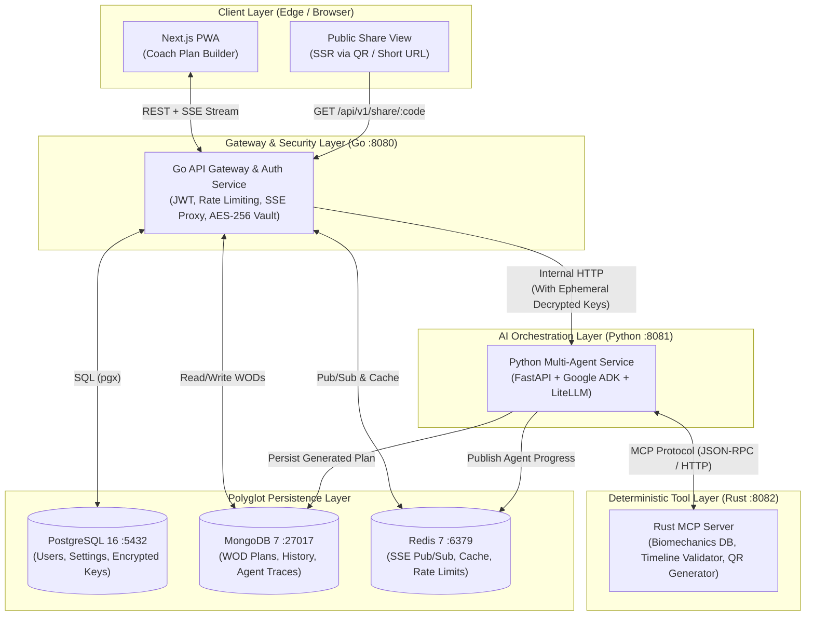

# CoachBuddy — Solutions Architecture & System Design Blueprint

> [!NOTE]
> **Architectural Intent:** CoachBuddy is designed both as a practical WOD plan builder for CrossFit/functional fitness coaches and as a **reference polyglot microservices & multi-agent system** demonstrating production-grade patterns for Senior Developer / Solutions Architect interviews.

---

## 1. Architectural Drivers & Technology Justification

In a system design interview, every technology choice must have a clear **"Why"**. Here is the architectural justification for the CoachBuddy stack:

| Component | Technology | Why This Technology? (The Architect's Pitch) |
| :--- | :--- | :--- |
| **Client & Public Share UI** | **TypeScript + Next.js (App Router, PWA)** | Provides installable mobile PWA capabilities (offline caching of saved WOD plans) alongside fast Server-Side Rendering (SSR) for shared public WOD links (`/s/[shortId]`) scanned via QR codes. |
| **API Gateway, Auth & Key Vault** | **Go (Chi)** | Low memory footprint, native concurrency (goroutines) for managing long-lived Server-Sent Events (SSE) streams to the client, strict typing for auth middleware, and rock-solid `crypto/cipher` primitives for **AES-256-GCM envelope encryption** of user LLM API keys. |
| **Multi-Agent Orchestrator** | **Python 3.12 + FastAPI + Google ADK + LiteLLM** | Python is the first-class ecosystem for **Google Agent Development Kit (ADK)**. Combining ADK's `SequentialAgent` and `ParallelAgent` primitives with **LiteLLM** enables provider-agnostic, per-agent routing (Gemini, OpenAI, Anthropic, Groq) using dynamic runtime keys. |
| **Domain Tooling & Compute** | **Rust (Axum + MCP JSON-RPC/SSE)** | Implements a high-performance **Model Context Protocol (MCP)** server over HTTP/SSE. Rust handles CPU-bound/deterministic tasks: exercise biomechanics graph traversal, strict timeline block math validation, and zero-allocation SVG QR code generation. |
| **Relational & Security Store** | **PostgreSQL 16** | ACID compliance for coach accounts, OAuth/JWT sessions, Box/Gym profiles, and encrypted BYOK (Bring Your Own Key) LLM provider credentials. |
| **Document & History Store** | **MongoDB 7** | WOD sessions are deeply nested, polymorphic documents (raw WOD input, vision OCR output, 4-tier scaling matrices, warm-up games, minute-by-minute timelines, and ADK agent execution traces). |
| **Event Bus, Cache & Rate Limiter** | **Redis 7** | Powers real-time **Pub/Sub** to stream granular agent progress events from Python ADK through the Go Gateway to the PWA, plus token-bucket rate limiting and fast resolution of shared WOD short-links. |

---

## 2. High-Level System Architecture

---

## 3. Multi-Agent Topology (Google ADK)

CoachBuddy uses **Google ADK's hierarchical agent composition** (`SequentialAgent` wrapping a `ParallelAgent` fan-out/fan-in pattern) to minimize latency while keeping each agent's context window focused:

1. **`WodParserAgent` (Vision & Structural Analyzer)**
2. **`ParallelStage` (`ParallelAgent`)**:
   - **`WarmupPlannerAgent`** (Calls Rust MCP `query_warmup_drills`)
   - **`ScalingAndCuesAgent`** (Calls Rust MCP `get_movement_substitutions`)
3. **`TimelineLogisticsAgent`** (Calls Rust MCP `validate_class_timeline`)

---

## 4. Service Port Matrix

| Service | Host Port | Container Port | Description |
| :--- | :--- | :--- | :--- |
| `pwa-nextjs` | `3000` | `3000` | CoachBuddy Next.js PWA & Share UI |
| `gateway-go` | `8080` | `8080` | Go API Gateway, Auth, BYOK Vault, SSE Stream |
| `agents-python` | `8081` | `8081` | Python FastAPI + Google ADK + LiteLLM Orchestrator |
| `mcp-rust` | `8082` | `8082` | Rust MCP Tool Server & SVG QR Generator |
| `postgres` | `5432` | `5432` | PostgreSQL 16 Relational & Encrypted Key Store |
| `mongodb` | `27017` | `27017` | MongoDB 7 WOD Session Document Store |
| `redis` | `6379` | `6379` | Redis 7 Event Pub/Sub & Cache |
