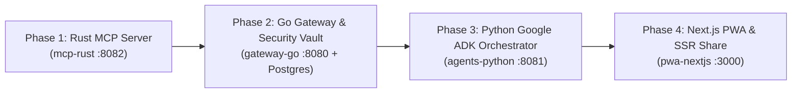

# CoachBuddy — Hands-On Guided Implementation Plan

> [!NOTE]
> **How Our Pair-Programming Workflow Works:**
> You don't have to write boilerplate, imports, or struct definitions. For each phase below:
> 1. **I (Antigravity)** will scaffold the files, types, imports, wiring, and unit tests, leaving focused **`TODO(engineer)`** blocks on the core algorithmic/architectural lines.
> 2. **You** open the target file in your IDE, fill in the core logic with my inline hints, and run the module's test command (`cargo test`, `go test`, `pytest`, `npm run build`) to see it pass!

---

## Self-Check Findings (Caught Before Writing Code)

During the final design self-audit against the codebase, 4 subtle integration catches surfaced and are baked into this plan:

1. **Async State in `mcp-rust`**: [`mcp.rs`](file:///D:/Development/CoachBuddy/services/mcp-rust/src/mcp.rs#L34) currently uses a synchronous `pub fn handle_mcp_request(req)` with no database state. To query MongoDB (`wod_sessions`) in `get_recent_coaching_history`, `handle_mcp_request` becomes `async` and receives Axum `State(AppState)` containing the MongoDB handle.
2. **Docker SSR Networking for `/s/[code]`**: In [`docker-compose.yml`](file:///D:/Development/CoachBuddy/docker-compose.yml#L114-L125), `pwa-nextjs` only had `NEXT_PUBLIC_API_URL=http://localhost:8080`. When Next.js Server Components prefetch `/s/[code]` inside a container, `localhost` points to the Next.js container itself. We will add `INTERNAL_GATEWAY_URL=http://gateway-go:8080` for SSR fetches while keeping `NEXT_PUBLIC_API_URL` for browser calls.
3. **Browser `EventSource` Auth**: The browser's native `EventSource` API cannot send `Authorization: Bearer` headers. The PWA will pass `?token=<jwt>` on `GET /api/v1/sessions/{id}/events?token=...`, which [`jwt.go`](file:///D:/Development/CoachBuddy/services/gateway-go/internal/auth/jwt.go#L82-L84) already extracts.
4. **PostgreSQL Init Migration**: [`init.sql`](file:///D:/Development/CoachBuddy/infra/postgres/init.sql#L17-L41) will be updated to enforce `UNIQUE(coach_id, provider)` (1 key slot per provider + `is_primary BOOLEAN`) and remove the unused `label` / `api_key_id` foreign-key indirection.

---

## Implementation Roadmap (4 Phases)



---

## Phase 1: Rust MCP Server (`services/mcp-rust`)

**Goal:** Strip out all hardcoded CrossFit strings and implement the 3 real deterministic MCP tools.

### Files We Will Touch
- [Cargo.toml](file:///D:/Development/CoachBuddy/services/mcp-rust/Cargo.toml) — *(I will scaffold)* Add `mongodb` + `futures-util` dependencies.
- [src/domain/history.rs](file:///D:/Development/CoachBuddy/services/mcp-rust/src/domain/history.rs) — *(New file: replaces `movements.rs` & `warmup.rs`)* Queries MongoDB `wod_sessions` for the coach's last 5 warm-ups.
- [src/domain/timeline.rs](file:///D:/Development/CoachBuddy/services/mcp-rust/src/domain/timeline.rs) — Pure `verify_timeline_math` verifier (checks `0..totalMinutes` contiguity and sum without overwriting LLM text).
- [src/domain/qr.rs](file:///D:/Development/CoachBuddy/services/mcp-rust/src/domain/qr.rs) — High-contrast dark-on-light QR code modules inside the Volt frame.
- [src/mcp.rs](file:///D:/Development/CoachBuddy/services/mcp-rust/src/mcp.rs) & [src/main.rs](file:///D:/Development/CoachBuddy/services/mcp-rust/src/main.rs) — Async JSON-RPC dispatcher with `AppState`.

### Your Hands-On Core Tasks in Phase 1
1. **`TODO(engineer) 1.1` in `src/domain/history.rs`**:
   - Build the MongoDB filter `doc! { "coachId": &input.coach_id, "status": "completed" }` and sort options `doc! { "createdAt": -1 }` with `limit(5)` to extract `gameTitle`, `style`, and `drillNames`.
2. **`TODO(engineer) 1.2` in `src/domain/timeline.rs`**:
   - Write the contiguity and sum invariant check loop over `blocks` (`start_min == expected_cursor`, `end_min > start_min`, final `end_min == total_minutes`) and compute `discrepancy_minutes` + `feasibility_status`.
3. **Verify Command**:
   ```powershell
   cd services/mcp-rust
   cargo test
   ```

---

## Phase 2: Go API Gateway, HKDF/AES-GCM Vault & Persistence (`services/gateway-go` + `infra/postgres/init.sql`)

**Goal:** Harden the BYOK Vault with HKDF + AES-256-GCM AAD, simplify to 1 key per provider (`isPrimary`), fix PostgreSQL/MongoDB persistence bugs, add Redis event buffering for SSE, and enforce rate limiting & ownership.

### Files We Will Touch
- [infra/postgres/init.sql](file:///D:/Development/CoachBuddy/infra/postgres/init.sql) — *(I will update)* `UNIQUE(coach_id, provider)` on `llm_api_keys` with `is_primary BOOLEAN`.
- [internal/crypto/vault.go](file:///D:/Development/CoachBuddy/services/gateway-go/internal/crypto/vault.go) & [internal/crypto/vault_test.go](file:///D:/Development/CoachBuddy/services/gateway-go/internal/crypto/vault_test.go) — HKDF per-coach key derivation + AES-256-GCM AAD (`coachId:provider`).
- [internal/auth/jwt.go](file:///D:/Development/CoachBuddy/services/gateway-go/internal/auth/jwt.go) — Reject invalid/expired JWTs with `401` instead of silently falling back to demo coach.
- [internal/store/store.go](file:///D:/Development/CoachBuddy/services/gateway-go/internal/store/store.go) — Fix `GetAgentPrefs` to query PostgreSQL, filter `ListSessions` by `coachId` (stripping `imageBase64` in list view), add MongoDB `{ coachId: 1, createdAt: -1 }` index, and add Redis caching + `expires_at` check on `GetSharedLink`.
- [internal/handlers/handlers.go](file:///D:/Development/CoachBuddy/services/gateway-go/internal/handlers/handlers.go) — Remove fake WOD fallback, enforce `RequireValidAPIKey` pre-check before calling Python, add `X-Internal-Gateway-Token`, replay buffered Redis SSE events in `StreamSessionEvents`, and strip coaching cues/notes when `includeCoachNotes == false`.

### Your Hands-On Core Tasks in Phase 2
1. **`TODO(engineer) 2.1` in `internal/crypto/vault.go`**:
   - Implement `deriveSubkey(coachID, provider string)` using `hkdf.New(sha256.New, v.masterKey, []byte(coachID), []byte(provider))` and pass `aad := []byte(coachID + ":" + provider)` into `gcm.Seal(nil, nonce, plaintext, aad)` and `gcm.Open(nil, nonce, ciphertext, aad)`.
2. **`TODO(engineer) 2.2` in `internal/store/store.go` (`BuildEphemeralRoutingConfig`)**:
   - Resolve each agent role (`parser`, `warmup`, `scaling`, `timeline`) to the coach's decrypted key for that role's `provider`, falling back to the coach's `isPrimary` key, and return an explicit error if a required provider key is missing.
3. **`TODO(engineer) 2.3` in `internal/handlers/handlers.go` (`ResolveShareLink`)**:
   - Implement the server-side sanitization when `!link.IncludeCoachNotes` (removing `exercises[].cues`, `timeline.blocks[].notes`, `timeline.coachWarnings`, and `agentTraces`).
4. **Verify Command**:
   ```powershell
   cd services/gateway-go
   go test -v ./...
   ```

---

## Phase 3: Python Google ADK Multi-Agent Orchestrator (`services/agents-python`)

**Goal:** True stage-by-stage Google ADK + LiteLLM execution with real-time Redis SSE event streaming, native multimodal image input (`Part.from_bytes`), `SecretStr` key protection, MCP tool calls (`get_recent_coaching_history` and `verify_timeline_math`), and strict Pydantic validation (zero silent fake fallbacks).

### Files We Will Touch
- [app/models.py](file:///D:/Development/CoachBuddy/services/agents-python/app/models.py) — *(I will scaffold)* `SecretStr` on `EphemeralAgentRoute.apiKey`, `extractedText` on `ParsedWodOutput`, `gameTitle` + `alternativeGames` + `drillNames` on `WarmupPlanOutput`.
- [app/mcp_client.py](file:///D:/Development/CoachBuddy/services/agents-python/app/mcp_client.py) — Clean JSON-RPC client for `get_recent_coaching_history` and `verify_timeline_math` (no duplicated CrossFit content).
- [app/adk_pipeline.py](file:///D:/Development/CoachBuddy/services/agents-python/app/adk_pipeline.py) — Stage-by-stage ADK runner, multimodal `Part.from_bytes` vision support, per-instance `LiteLlm` keys (no `os.environ` mutation), and live SSE event emission.
- [app/main.py](file:///D:/Development/CoachBuddy/services/agents-python/app/main.py) — Verify `X-Internal-Gateway-Token`, buffer SSE events in Redis (`RPUSH` + `EXPIRE` alongside `PUBLISH`), and remove duplicate MongoDB writes (Gateway is single writer).

### Your Hands-On Core Tasks in Phase 3
1. **`TODO(engineer) 3.1` in `app/adk_pipeline.py` (`build_multimodal_user_content`)**:
   - Decode `input.imageBase64` (stripping any `data:image/...;base64,` prefix) and construct `genai_types.Part.from_bytes(data=raw_bytes, mime_type=mime_type)` alongside the text prompt for `WodParserAgent`.
2. **`TODO(engineer) 3.2` in `app/adk_pipeline.py` (`execute` stage orchestration)**:
   - Wire the 3 sequential/parallel stages (`WodParserAgent` → `asyncio.gather(WarmupPlannerAgent, ScalingAndCuesAgent)` → `TimelineLogisticsAgent`), emitting `"running"` and `"completed"` SSE events around each stage and validating outputs with `ParsedWodOutput.model_validate()`, `WarmupPlanOutput.model_validate()`, etc.
3. **Verify Command**:
   ```powershell
   cd services/agents-python
   pytest -v
   ```

---

## Phase 4: Next.js PWA Frontend & SSR Share View (`web/pwa-nextjs`)

**Goal:** Modularize the 2,271-line `page.tsx`, connect real SSE progress streaming (`EventSource`), align Demo Coach credentials, simplify the BYOK Vault UI to 1-Key-Per-Provider, add 1-click Warm-up Game swapping, render QR SVGs safely via ``, and add SSR prefetching to `/s/[code]`. *(Keeping the Coach Floor Mode HUD untouched as agreed!)*

### Files We Will Touch
- [src/lib/api.ts](file:///D:/Development/CoachBuddy/web/pwa-nextjs/src/lib/api.ts) — Remove fake local key/session generators, surface real API errors, add `subscribeToSessionEvents(sessionId, onEvent)` using `EventSource`.
- `src/components/PlannerTab.tsx`, `src/components/ActiveSessionTab.tsx`, `src/components/HistoryTab.tsx`, `src/components/SettingsVaultTab.tsx`, `src/components/Modals.tsx` — Modular components extracted from `page.tsx`.
- [src/app/page.tsx](file:///D:/Development/CoachBuddy/web/pwa-nextjs/src/app/page.tsx) — Clean top-level shell coordinating state, SSE stepper updates, and tabs.
- [src/app/s/[code]/page.tsx](file:///D:/Development/CoachBuddy/web/pwa-nextjs/src/app/s/%5Bcode%5D/page.tsx) — Server Component wrapper prefetching `/api/v1/share/{code}` via `INTERNAL_GATEWAY_URL`.

### Your Hands-On Core Tasks in Phase 4
1. **`TODO(engineer) 4.1` in `src/lib/api.ts` (`subscribeToSessionEvents`)**:
   - Open `new EventSource(...)` with the session ID and JWT query param, parse incoming JSON step events (`parser`, `warmup`, `scaling`, `timeline`, `completed`, `error`), and invoke the UI stepper callback.
2. **`TODO(engineer) 4.2` in `src/components/ActiveSessionTab.tsx` (`handleSwapWarmupGame`)**:
   - Rotate `activeSession.warmup.phases[0]` with the next entry in `activeSession.warmup.alternativeGames` when the coach clicks **"Swap Warm-up Game"**.
3. **Verify Command**:
   ```powershell
   cd web/pwa-nextjs
   npm run build
   ```
