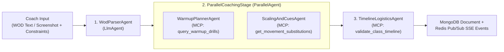

# CoachBuddy Multi-Agent Orchestrator (`agents-python`)

Python 3.12+ FastAPI microservice implementing CoachBuddy's **Google Agent Development Kit (ADK)** + **LiteLLM** multi-agent orchestration layer, backed by the **Rust Model Context Protocol (MCP)** domain server (`mcp-rust`).

---

## Multi-Agent Topology (`SequentialAgent` + `ParallelAgent`)



### Specialized Agents
1. **`WodParserAgent`**: Extracts workout blocks (`strength`, `skill`, `metcon`, `engine`), movement taxonomy, `primaryJoints`, and physiological `stimulus` from raw WOD text or whiteboard screenshots.
2. **`WarmupPlannerAgent`** (runs in `ParallelAgent` stage): Invokes `mcp-rust` (`query_warmup_drills`) to synthesize a 2-phase warm-up:
   - **Phase 1**: Fun non-repetitive Reaction / Broomstick / Partner Game to put athletes into sharp mental focus.
   - **Phase 2**: Biomechanical joint mobility & movement prep tailored to the WOD's primary joints.
3. **`ScalingAndCuesAgent`** (runs in `ParallelAgent` stage): Invokes `mcp-rust` (`get_movement_substitutions`) and generates for every WOD movement:
   - `cues.external` (2–3 punchy visual metaphors)
   - `cues.internal` (anatomical/bracing cues)
   - `cues.commonFaults` (`[{"fault": "...", "fix": "..."}]`)
   - `scaling`: `rxPlus`, `scaled`, `seniorsMasters`, and `injured` (`wristOrShoulder`, `kneePain`, `lowerBack`).
4. **`TimelineLogisticsAgent`**: Invokes `mcp-rust` (`validate_class_timeline`) to produce a strict minute-by-minute class schedule (`totalMinutes`, `feasibilityStatus`, `coachWarnings`, `blocks`).

---

## Resilient Hybrid Execution (Live ADK BYOK + Deterministic MCP Fallback)

- **Live Google ADK + LiteLLM Mode (`google-adk-litellm`)**: When the coach configures a Bring-Your-Own-Key (BYOK) credential in the Go Gateway Vault (or a default env key is set), each agent dynamically binds its own `LiteLlm(model=..., api_key=...)` instance (`gemini/gemini-2.5-flash`, `openai/gpt-4o`, `anthropic/claude-3-7-sonnet`, `groq/llama-3.3-70b-versatile`).
- **Zero-Key Demo / Resilient Mode (`mcp-hybrid-fallback`)**: If no API key is configured yet or an upstream LLM times out, the orchestrator automatically falls back to the deterministic Regex Parser + live Rust MCP tool pipeline so the application works out-of-the-box with zero external API keys required.

---

## Running Locally

```bash
pip install -r requirements.txt
uvicorn app.main:app --host 0.0.0.0 --port 8081 --reload
```

## Running Tests

```bash
pytest -v
```
