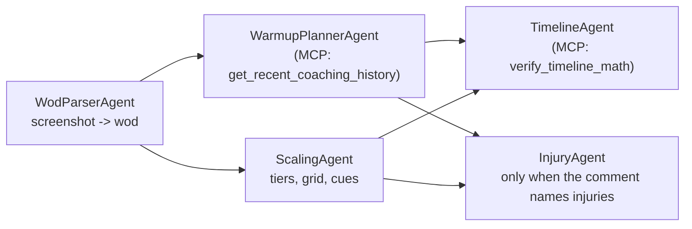

# agents-python

Builds a class plan from a WOD screenshot and the coach's comment (who attends today, injuries, warm-up wishes), on Google ADK with LiteLLM. Rules and layout: [AGENTS.md](AGENTS.md).

Each section is checked against the contract in `schema/`, gets one repair, or is reported as failed with the reason. There is no offline or canned mode: every plan comes from a real model with the coach's key.
